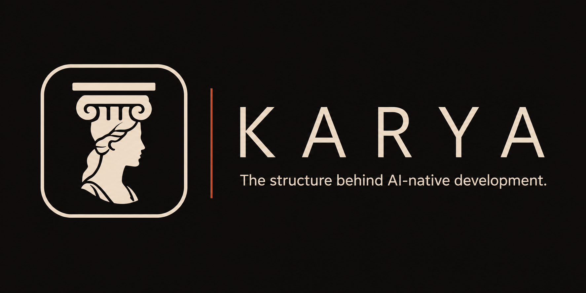
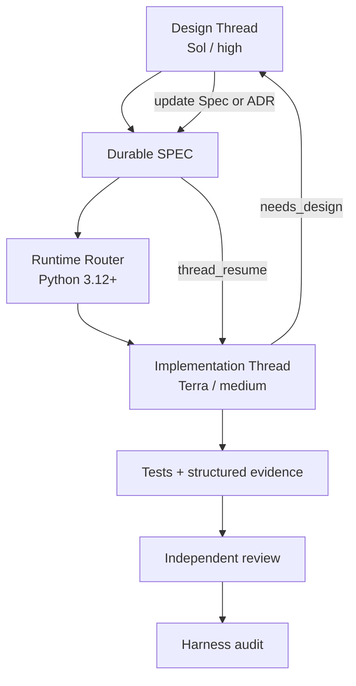

Karya is an open-source development system for Codex built around durable project knowledge, executable Specs, reusable Skills, isolated Threads, deterministic routing, validation, and evidence.

The name is inspired by the Caryatids of classical architecture—female figures used as structural supports. Karya applies that metaphor to AI-assisted development: it provides the structural layer that allows projects to grow without depending on the memory of a single conversation.

Each skill is a small, self-contained package centered on a `SKILL.md`, optionally backed by references, deterministic scripts, schemas, and assets.

Instead of letting an agent guess its way through a project, Karya uses:

- durable project knowledge;
- explicit Specs and contracts;
- reusable local skills;
- deterministic routing;
- isolated Codex threads;
- deliberate model and reasoning selection;
- validation and structured evidence;
- independent audits.

## Why Karya?

AI coding works well until important decisions start living only inside conversations. The result is lost context, architecture drift, repeated rediscovery, inconsistent execution, and decisions that cannot be reliably reproduced.

Karya moves that knowledge into durable artifacts.

```txt
Chat -> Agent -> Code
```

becomes:

```txt
Intent
  -> Durable knowledge
  -> Spec or contract
  -> Skill
  -> Deterministic routing
  -> Execution
  -> Evidence
  -> Audit
```

The goal is not to create more agents. The goal is to give AI development a structure strong enough to survive the conversations that created it.

## Why the name Karya?

Karya is a brand adaptation inspired by the Caryatids: female figures used as structural supports in classical architecture. Related male architectural figures are known as Atlantes or Telamons. Karya uses this history as a metaphor and identity, not as a literal translation of the word.

```txt
              Project
                 │
      ┌──────────┼──────────┐
      │          │          │
   Knowledge    Specs      Skills
      │          │          │
      └──────┬───┴───┬──────┘
             │       │
          Threads   Runtime
             │       │
             └───┬───┘
                 │
               KARYA
```

Karya is not the application being built. It is the structure that helps AI build and evolve it reliably.

## Start with Karya

You do not need to know the skill catalog before starting. After installing the repository, describe the objective to Karya:

```txt
$karya I want to create an automation that monitors processes and produces a daily report.
```

Karya inspects the request and relevant project context, consults its compact skill map, recommends the smallest suitable Factory, specialist skill, or direct-execution route, explains why, and waits for approval. After approval, Karya remains the conversational coordinator while the approved specialist skills work internally; the user does not need to invoke each one manually.

```txt
You -> $karya -> recommendation + reason -> approval -> specialist skills -> unified result
```

Karya is an optional coordination layer, not a fifth Factory. Direct skill invocation remains supported, and no cross-factory handoff happens automatically. See the [Karya routing model](docs/karya-routing.md).

## Four independent factories

| Factory | Use it when you want to... | Start with |
| --- | --- | --- |
| 🏗️ MVP Factory | Define, build, and deploy a product | `product-brief-architect` |
| 🔎 Research Factory | Research and challenge a market hypothesis | `market-research-architect` |
| 🚀 Marketing Factory | Prepare, launch, and evaluate go-to-market | `commercial-launch-architect` |
| 🧠 Project Harness Factory | Build the AI operating system of a project | `project-harness-architect` |

Every Factory is opt-in and independent. Research, Marketing, and Project Harness are not hidden prerequisites of MVP construction or of one another. Cross-factory handoffs require explicit user request or approval.

## Quick start

Clone the repository:

```bash
git clone https://github.com/viniciusjsdev/karya.git
cd karya
```

Install the skills using the [Windows](#windows--powershell) or [Linux/macOS](#linux--macos) instructions below. The simplest entry point is:

```txt
Use $karya to analyze this objective and project, recommend the smallest suitable route with reasons, and wait for my approval before applying specialist skills internally: <your objective>
```

You may also invoke a Factory entry skill directly when you already know the required workflow:

```txt
Use $project-harness-architect to audit this repository and prepare the minimum durable AI operating harness.

Use $project-spec-architect to turn the next bounded change into a READY Spec with explicit model, reasoning, thread, and validation policy.

Use $product-brief-architect to turn this idea into an executable product contract: <your idea>.

Use $market-research-architect to create a research contract for this market hypothesis: <your hypothesis>.

Use $commercial-launch-architect to create a launch contract for this existing product: <your product>.
```

Skills may also consume existing PRDs, repositories, research, launch plans, or other artifacts. You do not need to start from another Karya workflow.

## Core principles

**Artifacts over chat history**

Important knowledge must survive the conversation that created it.

**Architect ≠ Executor ≠ Auditor**

The agent that defines a contract should not silently redefine it while executing or self-approve incomplete evidence.

**Smallest capable runtime**

Use the least expensive model and reasoning level capable of completing the work reliably.

**Skills over agent proliferation**

Specialization comes primarily from reusable skills, not large subagent trees.

**Deterministic operations belong in code**

If a script can reliably validate or route something, do not ask another LLM to decide it.

**Progressive context disclosure**

Threads receive the smallest useful context and load more only when required.

**Explicit boundaries**

Factories, external operations, credentials, spending, and consequential product decisions never become implicit stages.

## Karya Project Harness

Project Harness is the Factory that most directly expresses Karya's core idea: project knowledge must outlive the AI thread that discovered it. It makes a project resumable by clean Codex threads without copying design-chat history into execution.



Threads do not communicate through chat history. They communicate through durable artifacts:

- Specs;
- ADRs and decisions;
- project documentation;
- reusable skills;
- code and Git history;
- structured completion and review evidence.

The runtime router uses Python 3.12+ and the official Python Codex SDK directly. Persistent operational knowledge stays in `.codex/`; gitignored thread mappings, usage, temporary receipts, and runtime status stay in `.harness/runtime/`.

### Default runtime routing

| Work | Default runtime |
| --- | --- |
| Architecture or unresolved design | Sol + high |
| Normal, well-defined implementation | Terra + medium |
| Complex but resolved implementation | Terra + high |
| Mechanical, low-risk work | Luna + low |
| Critical independent review | Sol + high |

File count is not complexity. A 100-file mechanical rename may fit Luna; a three-file architectural change may require Sol.

### What gets created in a project?

```txt
your-project/
├── AGENTS.md                 # routing and repository rules
├── .agents/
│   └── skills/               # recurring project-local procedures
├── .codex/                   # persistent operational context
│   ├── references/
│   ├── workflows/
│   ├── checklists/
│   └── decisions/
├── .harness/
│   └── runtime/              # ignored, ephemeral execution state
├── docs/                     # project and domain truth
└── specs/                    # bounded executable changes
```

The exact structure adapts to the repository. Existing documentation and richer domain contracts are preserved rather than flattened or overwritten.

See the [Project Harness architecture](docs/project-harness-factory.md), its [durable contract](specs/project-harness-contract.md), and the [SPEC-023 executable example](examples/project-harness/spec-023-sensor-export/).

## MVP, Research, and Marketing

| Factory | What it produces | Learn more |
| --- | --- | --- |
| MVP | Explicit product, frontend, backend, infrastructure, and validation contracts leading to a testable product | [Generation flow](docs/project-generation-flow.md) · [Backend execution](docs/opencode-backend-execution.md) · [Product contract](specs/product-contract.md) |
| Research | Hypotheses, falsifiers, evidence tasks, source lineage, adversarial validation, and a next experiment | [Research workflow](docs/research-workflow.md) · [Research contract](specs/market-research-contract.md) |
| Marketing | Positioning, offers, creative assets, bounded execution, measurement, and commercial learning | [Marketing workflow](docs/marketing-workflow.md) · [Codex/Manus integration](docs/codex-manus-integration.md) · [Launch contract](specs/commercial-launch-contract.md) |

Account creation, credentials, paid activation, consequential product decisions, and cross-factory handoffs remain explicit human-controlled boundaries.

## Requirements

Core:

- [OpenAI Codex](https://developers.openai.com/codex/);
- Git.

Project Harness:

- Python 3.12+;
- the pinned official Python Codex SDK when performing live runtime routing.

Existing MVP, Research, and Marketing mechanisms may additionally use:

- Node.js 24+;
- npm;
- provider-specific tools documented by their owning skill.

Karya is designed and tested for OpenAI Codex. Other coding agents may reuse the underlying Markdown workflows, but Codex-specific metadata, runtime routing, thread management, and installation paths may require adaptation.

## Installation

### Windows / PowerShell

```powershell
$codexHome = if ($env:CODEX_HOME) { $env:CODEX_HOME } else { Join-Path $env:USERPROFILE ".codex" }
$skillsHome = Join-Path $codexHome "skills"
New-Item -ItemType Directory -Force $skillsHome | Out-Null

Get-ChildItem .\skills -Directory | ForEach-Object {
  Copy-Item -Recurse -Force $_.FullName (Join-Path $skillsHome $_.Name)
}
```

### Linux / macOS

```bash
export CODEX_HOME="${CODEX_HOME:-$HOME/.codex}"
mkdir -p "$CODEX_HOME/skills"
cp -R skills/. "$CODEX_HOME/skills/"
```

Each folder under `skills/` is independently installable. To install only one skill, copy only that folder into `$CODEX_HOME/skills/`.

For live Project Harness routing, create an isolated Python environment and install:

```bash
python -m pip install -r skills/codex-runtime-router/requirements.txt
python skills/codex-runtime-router/scripts/codex_runtime_doctor.py
```

## Skill catalog

The repository currently contains one optional Karya coordination skill plus 21 independent specialist skills across the four Factories. The complete responsibility, trigger, and boundary catalog lives in [specs/skill-catalog.md](specs/skill-catalog.md).

## Architecture and documentation

- [Karya architecture](docs/karya-architecture.md)
- [Karya routing and coordination](docs/karya-routing.md)
- [Factory workflow map](docs/factory-workflow-map.md)
- [Project Harness architecture](docs/project-harness-factory.md)
- [Project Harness contract](specs/project-harness-contract.md)
- [MVP generation flow](docs/project-generation-flow.md)
- [Backend execution](docs/opencode-backend-execution.md)
- [Research workflow](docs/research-workflow.md)
- [Marketing workflow](docs/marketing-workflow.md)
- [Cross-factory handoffs](specs/factory-handoff-contracts.md)
- [Complete skill catalog](specs/skill-catalog.md)

## Validation

Validate every skill definition:

```powershell
$codexHome = if ($env:CODEX_HOME) { $env:CODEX_HOME } else { Join-Path $env:USERPROFILE ".codex" }
$quickValidate = Join-Path $codexHome "skills\.system\skill-creator\scripts\quick_validate.py"

Get-ChildItem .\skills -Directory | ForEach-Object {
  python $quickValidate $_.FullName
}
```

Run the Project Harness deterministic suite:

```bash
python -m pip install -r skills/codex-runtime-router/requirements-dev.txt
python -m pytest \
  skills/project-harness-architect/scripts/test_harness_bootstrap.py \
  skills/project-spec-architect/scripts/test_spec_validator.py \
  skills/project-skill-author/scripts/test_project_skill_validator.py \
  skills/codex-runtime-router/scripts/test_runtime_router.py \
  skills/project-harness-auditor/scripts/test_harness_auditor.py \
  examples/project-harness/spec-023-sensor-export/project/tests/test_sensor_export.py -q
```

Factory-specific validators and tests remain inside their owning skill folders.

## Repository structure

```txt
karya/
├── skills/       # independently installable Codex skills
│   ├── karya/     # optional conversational coordinator
│   ├── <MVP Factory skills>
│   ├── <Research Factory skills>
│   ├── <Marketing Factory skills>
│   └── <Project Harness Factory skills>
├── docs/         # architecture and workflow documentation
├── specs/        # durable contracts and catalogs
├── .codex/       # repository-level Codex workflows and references
├── templates/    # reusable generated-project starter material
├── examples/     # sample contracts and project structures
├── AGENTS.md
├── CONTRIBUTING.md
├── LICENSE
└── README.md
```

Start with `$karya` when the correct route is unclear, or invoke a specialist directly when it is already known. Use optional handoff artifacts when another Factory becomes useful; do not turn the four workflows into one mandatory pipeline.

## Contributing

Contributions to skills, deterministic tooling, tests, examples, documentation, and cross-platform support are welcome. Read [CONTRIBUTING.md](CONTRIBUTING.md) for the skill package format, runtime conventions, validation requirements, and pull-request checklist.

## License

Karya is available under the [MIT License](LICENSE).
